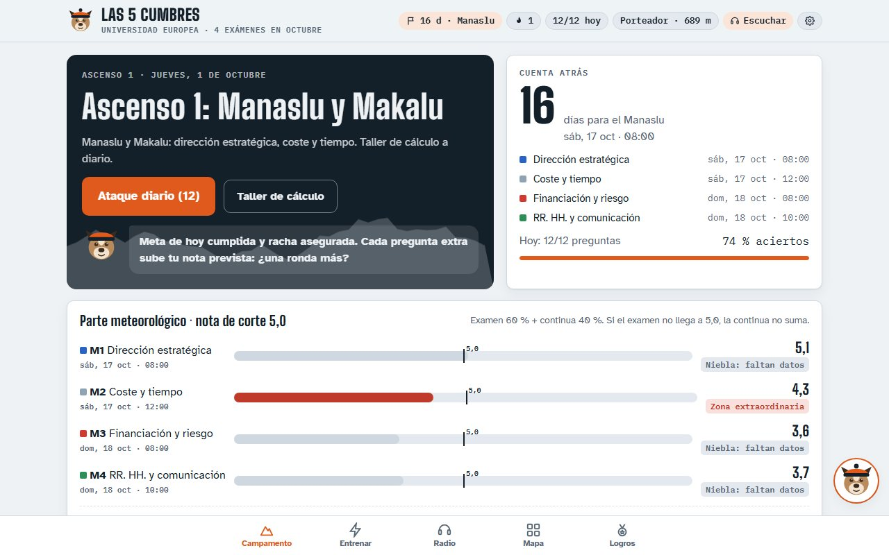
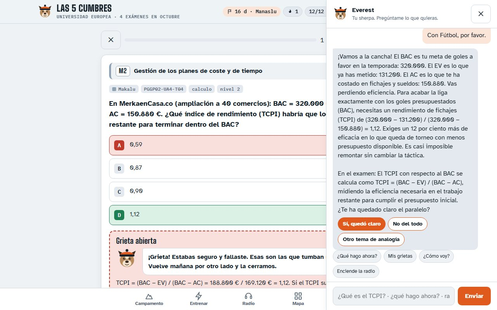
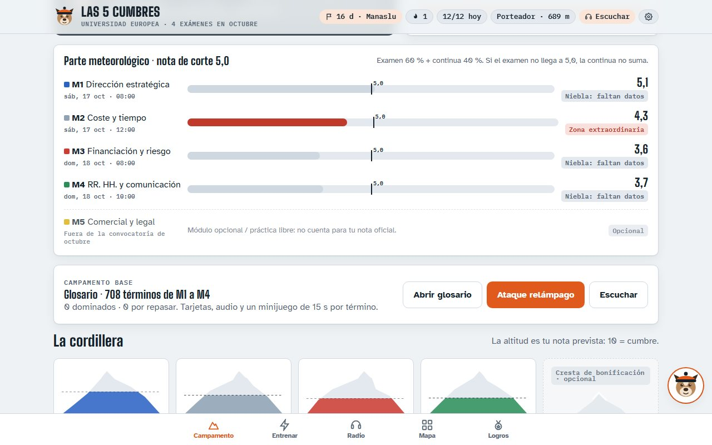
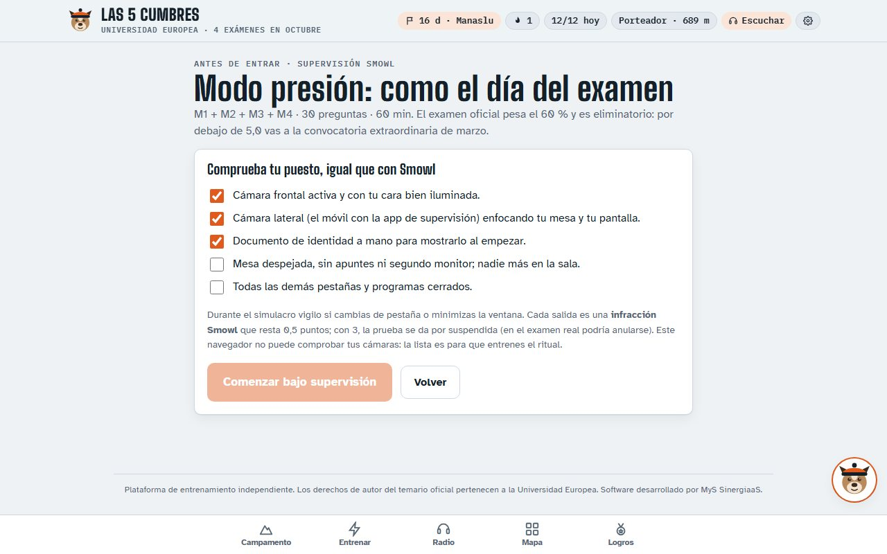
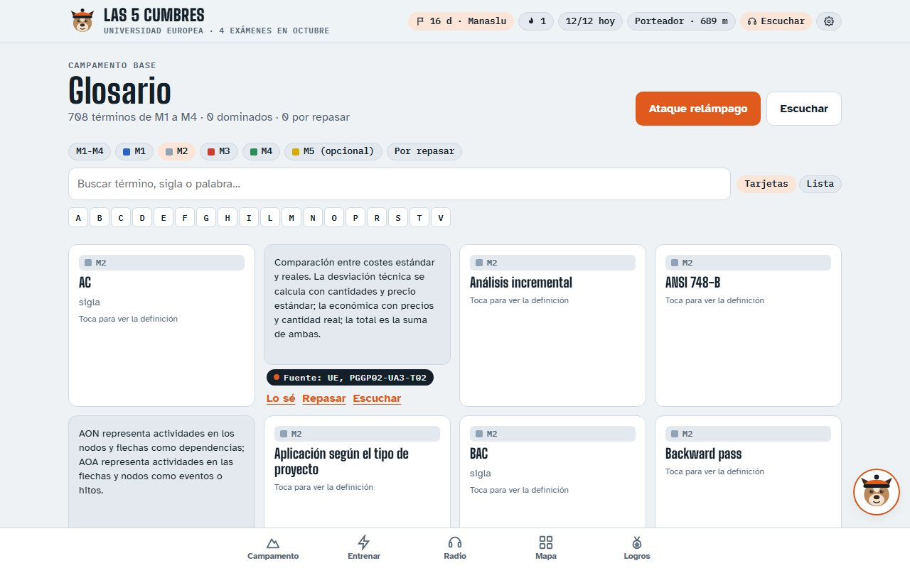
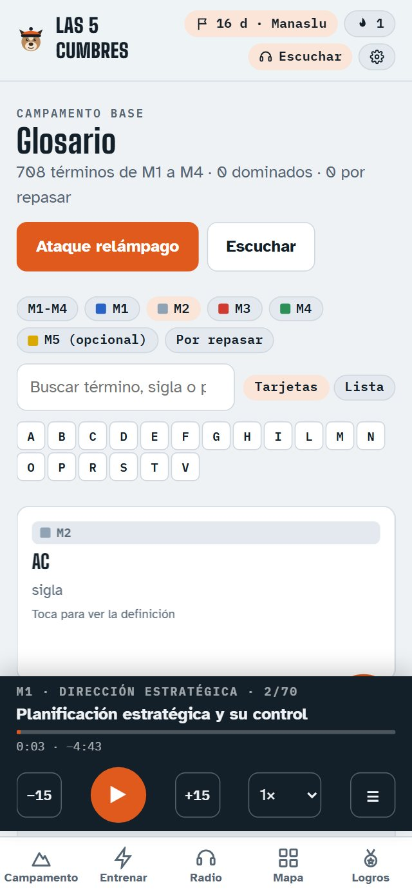

<picture>
  <source media="(prefers-color-scheme: dark)" srcset="assets/mys-logo-blanco.png">
  
</picture>

# 🏔️ Las 5 Cumbres

### Entrenador SaaS para aprobar las pruebas finales de un máster en dirección de proyectos

**MyS SinergiaaS** — Consultoría y Tecnología
*Automatiza. Escala. Vende.*

`En producción` · `Acceso por licencia` · `Demo gratuita` · `Mentor con IA` · `Funciona en el celular`

---

## El problema

Dos semanas antes de los exámenes, un estudiante de máster tiene delante decenas
de temas, cientos de páginas y una prueba virtual supervisada que es
**eliminatoria**: si no la aprueba, el resto de su nota no cuenta.

Releer apuntes no le dice dónde está flojo, cuánto le falta para el corte ni qué
estudiar mañana. Y las dudas que más puntos cuestan son las que cree dominar.

## La solución

**Las 5 Cumbres convierte la preparación en una expedición: una cumbre por
examen, una misión cada día y un guía que no suelta al estudiante hasta la cima.**

La guía es **Everest**, el perro de montaña de
[Cumbre DOFA](https://cumbre-dofa.vercel.app), [La Ruta de la Cima Digital](https://ruta-cima-digital.vercel.app)
y el [Taller de Marca en Vivo](https://taller-marca-vivo.vercel.app).

### Apostar antes de responder
Antes de cada respuesta, el estudiante apuesta **«Seguro» o «Duda»**. Fallar
estando seguro abre una **grieta**: ese concepto vuelve en los días siguientes,
cada vez desde otro ángulo, hasta que queda cerrado.

### Un mentor que explica con lo que te gusta

Cuando se abre una grieta, Everest toma la iniciativa: pregunta por una afición
(fútbol, cocina, autos…) y explica el concepto con una analogía de ese mundo,
con los mismos números del ejercicio, y termina traduciéndola a los términos
del examen.

### Saber si se llega al corte

El **parte meteorológico** muestra, examen por examen, la nota prevista frente
al corte de 5,0: zona segura, zona ordinaria o peligro de convocatoria
extraordinaria.

### Simulacros como el día del examen

Simulacros cronometrados con la misma mezcla del examen, un ritual de
supervisión previo y penalización si el estudiante sale de la pestaña. También
simulacros a la carta: de 5 a 150 preguntas, con o sin reloj.

### Glosario, cálculo y una radio para el carro

<table>
<tr>
<td width="60%"></td>
<td width="40%"></td>
</tr>
</table>

- **Glosario** con más de 700 términos en tarjetas que giran y un minijuego de
  15 segundos por término.
- **Taller de cálculo** con ejercicios que nunca se repiten: valor ganado,
  PERT, ruta crítica, VAN, TIR, ratios y valor monetario esperado.
- **Radio Temario · Modo Carretera**: el temario y el glosario narrados para
  estudiar escuchando, con saltos de 15 segundos y velocidad ajustable.

## El resultado

| | |
|---|---|
| **1.300+** | preguntas que citan el temario |
| **700+** | términos en el glosario, con audio |
| **16** | tipos de ejercicio de cálculo infinitos |
| **4** | exámenes con nota prevista frente al corte |

El estudiante sabe cada mañana qué estudiar y llega al simulacro final habiendo
cerrado las dudas que de verdad le iban a costar puntos.

## Un producto, no un prototipo

- **Licencias por estudiante:** el administrador entrega claves personales desde
  su panel, puede activarlas o desactivarlas al instante y la sesión es única.
- **Contenido protegido:** el material solo se descarga con una licencia activa.
- **Demo gratuita** para probar antes de pagar.
- **Aviso legal y aceptación de términos** con registro de fecha.
- **Progreso en la nube:** el estudiante continúa en el celular donde lo dejó en el PC.

## Stack (lo que se ve)

`SaaS` · `Licencias por usuario` · `IA generativa` · `Repetición espaciada` ·
`Gamificación` · `Texto a voz` · `JavaScript` · `Funciones serverless` ·
`Base de datos en la nube` · `Vercel`

> Este repositorio es una **vitrina**: muestra el producto y su resultado. El
> motor de entrenamiento, el banco de preguntas y la lógica del servidor son
> propiedad de MyS SinergiaaS y no se publican.

---

**¿Quieres un entrenador así para tu programa, tu certificación o tu equipo?**

[Escríbenos por WhatsApp](https://wa.me/573148788974) · [Ver el portafolio](https://mac-saenz-portafolio.vercel.app)

*Plataforma de entrenamiento independiente. Los derechos de autor de los temarios
oficiales pertenecen a sus instituciones.*

**MyS SinergiaaS** — Automatiza. Escala. Vende.

